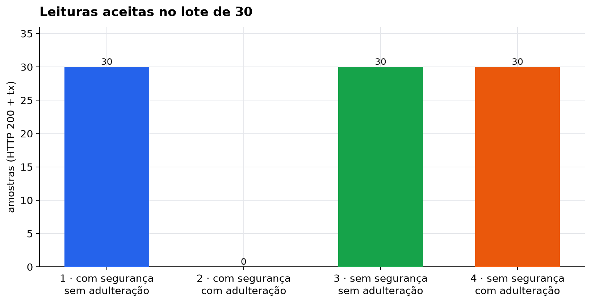
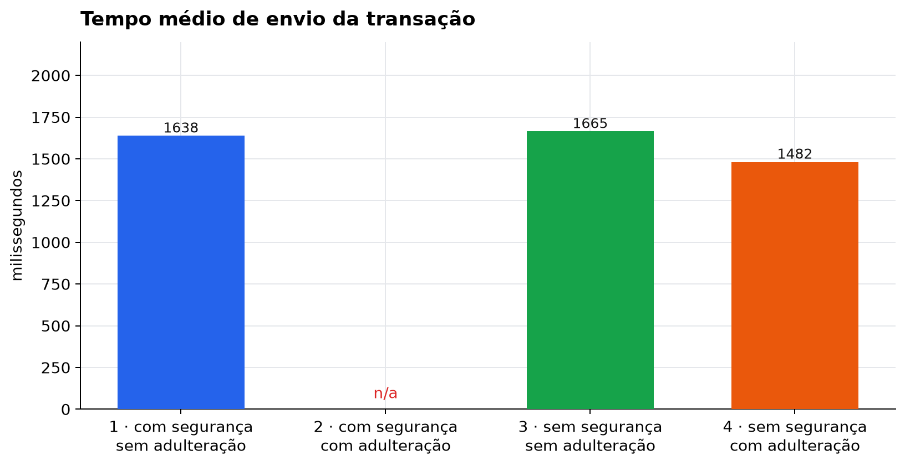
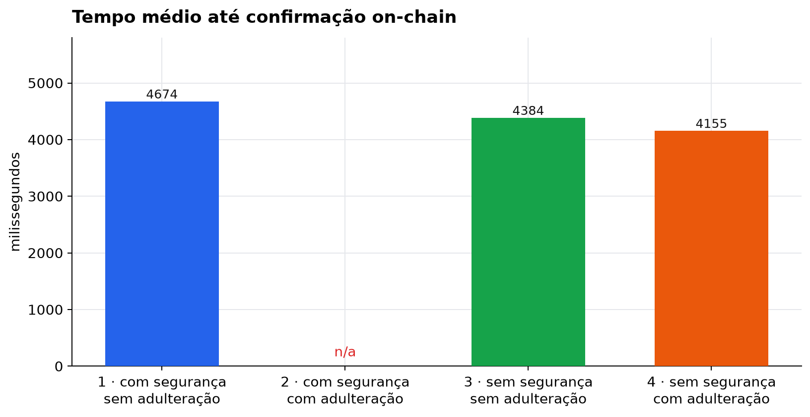
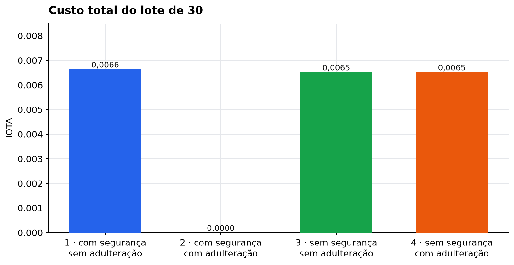
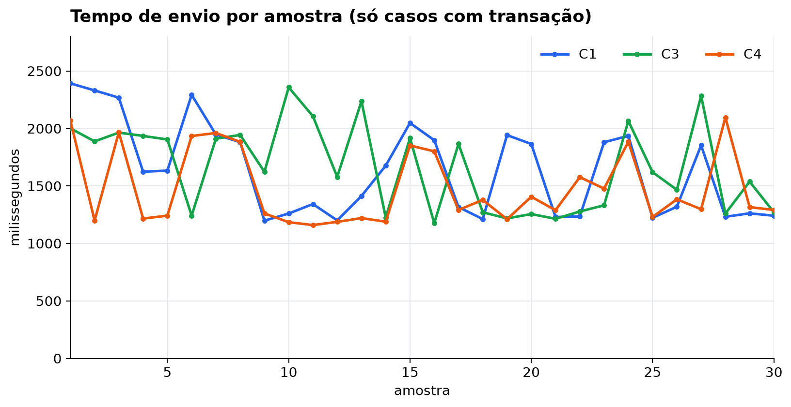
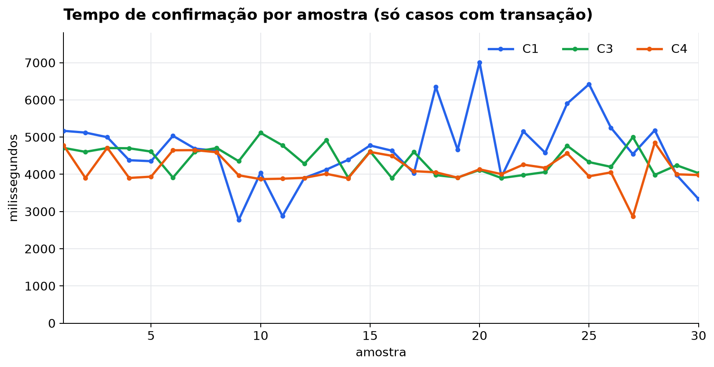

# Comparação dos 4 casos

Lote de **30** amostras em cada célula. Mesmo contrato ESDRA `registrar` (`0xDAc95e767da4376456b132F4b78e18C0b8d0C669`). A variável de segurança é só a allowlist de hash no relay (`:5000/atestar` vs `:5001/leitura`).

**Resultado:** só o caso 2 é recusado (HTTP 403). Sem allowlist, a adulteração do `.ino` (caso 4) grava na cadeia igual ao firmware limpo (caso 3).

| cor | caso | segurança | adulteração | HTTP | tx | amostras |
|---|---|---|---|---|---|---:|
| azul | 1 | com | não | 200 | sim | 30/30 |
| vermelho | 2 | com | sim | **403** | não | 0/30 |
| verde | 3 | sem | não | 200 | sim | 30/30 |
| laranja | 4 | sem | sim | 200 | sim | 30/30 |

## Parâmetros essenciais (média do lote 30)

| parâmetro | Caso 1 | Caso 2 | Caso 3 | Caso 4 |
|---|---:|---:|---:|---:|
| Leituras aceitas | 30 | 0 | 30 | 30 |
| Tempo médio de envio (ms) | 1638,23 | — | 1664,76 | 1481,69 |
| Tempo médio de confirmação (ms) | 4673,75 | — | 4384,17 | 4154,59 |
| Custo médio (IOTA) | 0,000221 | 0 | 0,000217 | 0,000217 |
| Custo total (IOTA) | 0,0066327 | 0 | 0,0065175 | 0,0065175 |
| Gas médio | 22109 | — | 21725 | 21725 |
| Quando | 27/10 17:05 → 29/10 15:56 | 29/10 16:12–16:17 | 29/10 16:42–16:49 | 29/10 17:02–17:09 |

No caso 2 não há tempo de envio, confirmação nem custo: o relay barra o hash antes de chamar o contrato.

## Gráficos

Azul = caso 1 · vermelho = caso 2 · verde = caso 3 · laranja = caso 4.

### Leituras aceitas

### Tempo médio de envio

### Tempo médio de confirmação

### Custo total (IOTA)

### Série temporal — envio

O caso 2 não entra nestas linhas: não há transação.

### Série temporal — confirmação

## Leitura

- **Allowlist funciona:** casos 1 e 2 diferem só na adulteração; o 2 zera tx e custo.
- **Sem allowlist a adulteração passa:** casos 3 e 4 têm o mesmo custo (0,000217 IOTA / leitura; 0,0065175 no lote) e HTTP 200.
- **Overhead de atestação no envio** é pequeno neste lote (caso 1: 1638 ms vs caso 3: 1665 ms). A confirmação do caso 1 foi a mais lenta (4674 ms).

Fichas: [caso 1](caso-01-com-seguranca-sem-adulteracao.md) · [caso 2](caso-02-com-seguranca-adulteracao.md) · [caso 3](caso-03-sem-seguranca-sem-adulteracao.md) · [caso 4](caso-04-sem-seguranca-adulteracao.md)
